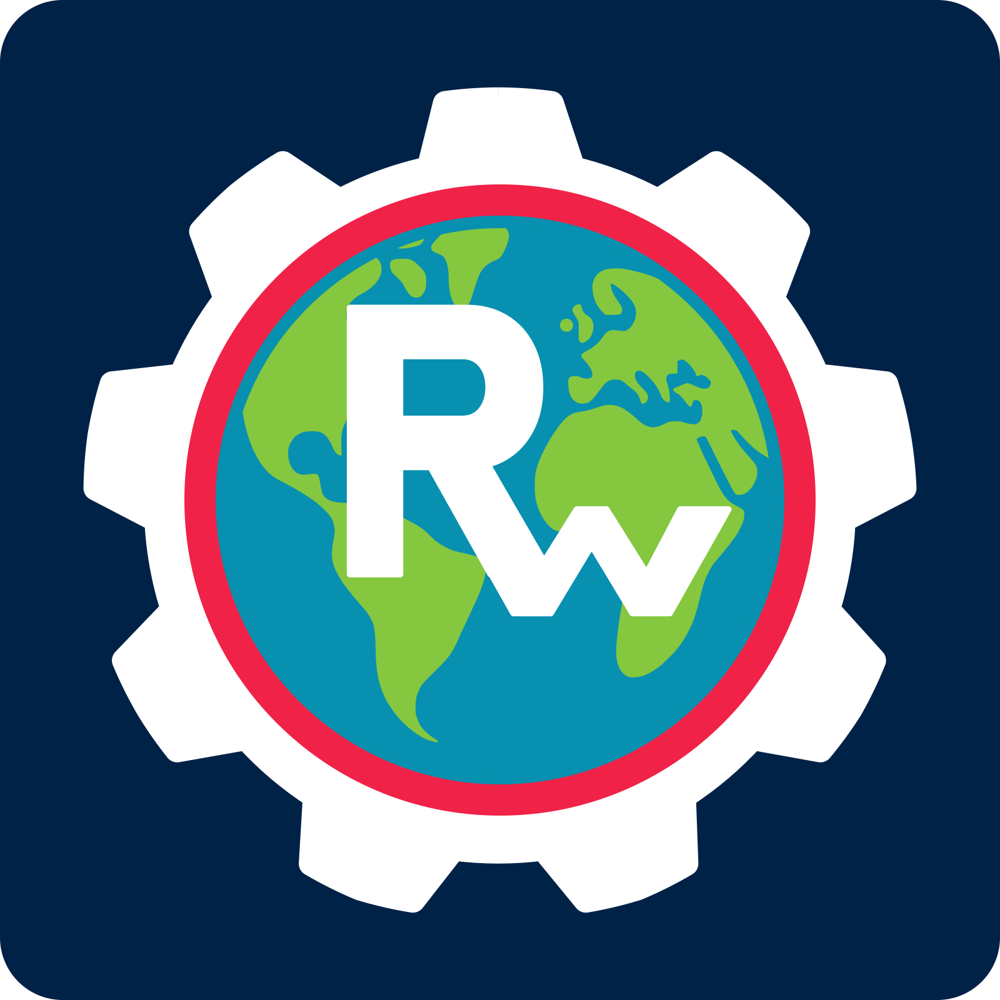

#  RESTworld

[
](LICENSE)

[](https://www.nuget.org/packages/RESTworld.AspNetCore/)
[](https://www.nuget.org/packages/RESTworld.AspNetCore/)

[](https://www.nuget.org/packages/RESTworld.Business/)
[](https://www.nuget.org/packages/RESTworld.Business/)

[](https://www.nuget.org/packages/RESTworld.Client.AspNetCore/)
[](https://www.nuget.org/packages/RESTworld.Client.AspNetCore/)

[](https://www.nuget.org/packages/RESTworld.Client.Net/)
[](https://www.nuget.org/packages/RESTworld.Client.Net/)

[](https://www.nuget.org/packages/RESTworld.Common/)
[](https://www.nuget.org/packages/RESTworld.Common/)

[](https://www.nuget.org/packages/RESTworld.EntityFrameworkCore/)
[](https://www.nuget.org/packages/RESTworld.EntityFrameworkCore/)

[](https://www.nuget.org/packages/RESTworld.Testing/)
[](https://www.nuget.org/packages/RESTworld.Testing/)

[](https://www.npmjs.com/package/@wertzui/ngx-restworld-client)
[](https://www.npmjs.com/package/@wertzui/ngx-restworld-client)


RESTworld is a developer-focused framework that turns ASP.NET Core and Entity Framework Core into a fully RESTful, HAL-compliant platform. It combines well-known building blocks with batteries-included conventions so you can deliver production-ready APIs quickly.

## Key capabilities

- Opinionated pipelines for read and CRUD scenarios, with extensibility hooks when you need to customize.
- Out-of-the-box support for HAL, HAL-FORMS, and OData (query, paging, templated links).
- Mapperly-based mapping, resource-based authorization, and API versioning baked into the request flow.
- Telemetry via OpenTelemetry, health endpoints for readiness/liveness/startup, and Aspire integration for local orchestration.
- An [AI agent plugin](#ai-agent-plugin) with skills that help your coding agent build on RESTworld.

## Getting started

1. Follow the [Getting Started](doc/getting-started.md) guide to scaffold your solution and wire up RESTworld services.
2. Configure runtime behavior with [Configuration](doc/configuration.md), and review [Pipeline Overview](doc/pipeline-overview.md) to choose the right pipeline.
3. Secure your endpoints using [Authorization](doc/authorization.md) and fine-tune DTO mappings with [Mapping and Versioning](doc/mapping-and-versioning.md).

Need a reference implementation? Explore [`src/Example/ExampleBlog`](src/Example/ExampleBlog).

Using an AI coding agent? Install the [RESTworld plugin](#ai-agent-plugin) first, so it follows the framework conventions from the start.

## Documentation map

- [RESTworld documentation index](doc/index.md)
- [Using RESTworld with AI agents](doc/ai-agents.md)
- [How-To Cookbook](doc/how-to.md)
- [Choosing a Pipeline](doc/choosing_a_pipeline.md)
- [Health and Operations](doc/health-and-operations.md)
- [Angular Client Development](doc/client-development-angular.md)
- [.NET Client Development](doc/client-development-dotnet.md)

The documentation targets developers who build APIs and client applications on top of the RESTworld libraries. If you're looking for a higher-level pitch, read the refreshed [README-short](README-short.md).

## AI agent plugin

RESTworld ships a plugin with 17 skills for AI coding agents such as GitHub Copilot. The skills teach an agent how to build applications **with** RESTworld: adding an entity endpoint, DTOs, mappers, services, authorization, validation, API versions, tests, the .NET client and Angular pages. They are meant for developers who use the library, not for developers of the library itself.

Install it in Copilot CLI (the plugin has its own small repository, [RESTworld-AI-plugin](https://github.com/wertzui/RESTworld-AI-plugin), so you do not have to clone the whole source tree):

```shell
copilot plugin marketplace add wertzui/RESTworld-AI-plugin
copilot plugin install restworld@restworld
```

Then ask your agent for a task, for example "add a `Product` endpoint". If the agent does not pick a skill, name it: "use the `restworld-add-entity-endpoint` skill".

- The skills live in [`plugins/restworld/skills`](plugins/restworld/skills). You can also copy them into your own repository (for example `.github/skills/`) if your agent has no plugin support.
- Copy [`AGENTS.md`](src/Example/ExampleBlog/AGENTS.md) to the root of your solution so the agent knows the project layout and rules.
- See [Using RESTworld with AI agents](doc/ai-agents.md) for installation in VS Code (add `wertzui/RESTworld-AI-plugin` to the `chat.plugins.marketplaces` setting), for a team-wide setup and for tips, and the [How-To Cookbook](doc/how-to.md) for the full list of skills.

## Contributing and feedback

- File issues or feature requests via [GitHub Issues](https://github.com/wertzui/RESTworld/issues).
- Share ideas or improvements through pull requests—guided by the documentation above.

Enjoy building RESTful applications with RESTworld!
