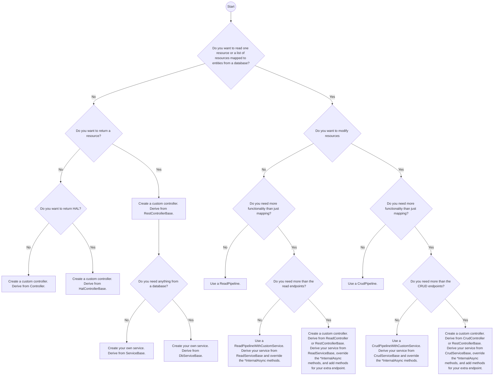

# Choosing a Pipeline

RESTworld is highly configurable and offers multiple pipelines for different scenarios. If you are unsure which option fits best, start with the [Pipeline Overview](pipeline-overview.md) for context, then use the flowchart below to pick the right implementation strategy.

Notes:

- Controllers are discovered automatically by ASP.NET Core. Register only the service, mapper and authorization handler. See [Custom Controllers](custom-controllers.md) and [Services](services.md).
- The `...WithCustomService` registration methods have no `ApiVersion` parameter. A versioned endpoint that needs a custom service uses a custom controller with `[ApiVersion]`.
