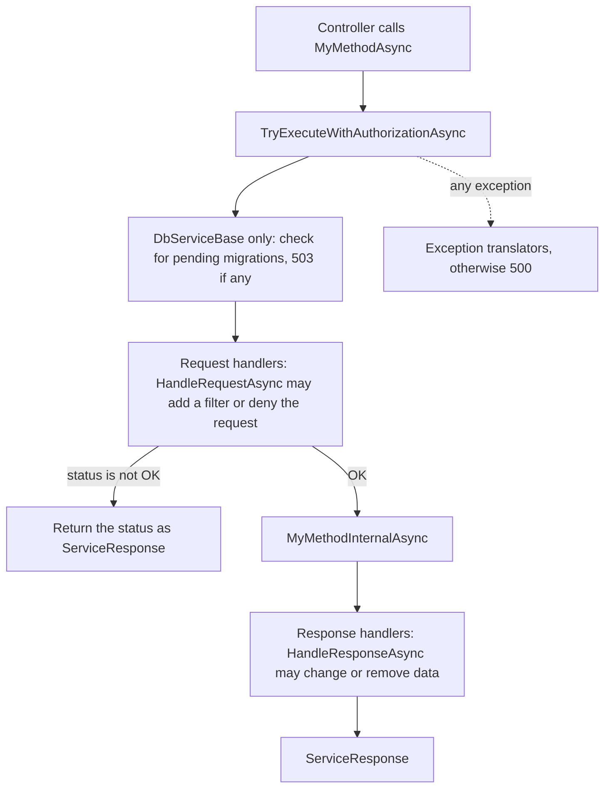

# Custom Services

A service contains the business logic behind an endpoint. The built-in pipelines use `CrudServiceBase` and `ReadServiceBase` as they are. Derive from them (or from `DbServiceBase` / `ServiceBase`) when you need to add logic: fill properties that are not stored in the database, trigger side effects on create/update/delete, change which rows are read, or serve data that does not come from the database at all.

Decide first whether you need a service at all with [Choosing a Pipeline](choosing_a_pipeline.md).

## Base classes

All base classes are in the `RESTworld.Business.Services` namespace.

| Base class | Use it for |
|---|---|
| `CrudServiceBase<TContext, TEntity, TCreateDto, TQueryDto, TGetListDto, TGetFullDto, TUpdateDto>` | Custom logic for a full CRUD pipeline. Derives from `ReadServiceBase`. |
| `ReadServiceBase<TContext, TEntity, TQueryDto, TGetListDto, TGetFullDto>` | Custom logic for a read-only pipeline. Derives from `DbServiceBase<TContext>`. |
| `DbServiceBase<TContext>` | Services for custom controllers that use the database. Provides migration check, exception translation and authorization helpers. |
| `ServiceBase` | Services without a database (HTTP calls, files, ...). Provides logging, the user accessor, `TryExecuteAsync` and authorization helpers. |

`TContext` derives from `DbContextBase`. CRUD entities derive from `ConcurrentEntityBase`, read-only entities from `EntityBase`.

## Choosing the base class

Answer these questions in order:

1. **Do you change how a standard entity endpoint (`GET`, `POST`, `PUT`, `DELETE` of a registered pipeline) behaves?**
   - It modifies data: derive from `CrudServiceBase` and register it with `AddCrudPipelineWithCustomService...`.
   - It is read-only: derive from `ReadServiceBase` and register it with `AddReadPipelineWithCustomService...`.
2. **Otherwise** (a custom controller, a non-standard operation): does the method use the database?
   - Yes: derive from `DbServiceBase<TContext>`. You get the migration check, exception translators and authorization with entity filters.
   - No: derive from `ServiceBase`. You get logging, the user accessor, exception handling and authorization without a database.

Always pick the most specific base class that fits. A `CrudServiceBase` or `ReadServiceBase` service can also contain additional methods of its own, written with the pattern from [Writing your own service methods](#writing-your-own-service-methods), because both derive from `DbServiceBase`.
## Constructor dependencies

Pass everything to the base constructor. The service is resolved from dependency injection, so you can add your own dependencies as well.

```csharp
public class PostService : CrudServiceBase<BlogDatabase, Post, PostCreateDto, PostQueryDto, PostListDto, PostGetFullDto, PostUpdateDto>
{
    public PostService(
        IDbContextFactory<BlogDatabase> contextFactory,
        ICrudMapper<Post, PostCreateDto, PostQueryDto, PostListDto, PostGetFullDto, PostUpdateDto> mapper,
        IEnumerable<ICrudAuthorizationHandler<Post, PostCreateDto, PostQueryDto, PostListDto, PostGetFullDto, PostUpdateDto>> authorizationHandlers,
        IValidationService<PostCreateDto, PostUpdateDto, Post> validationService,
        IUserAccessor userAccessor,
        ILogger<CrudServiceBase<BlogDatabase, Post, PostCreateDto, PostQueryDto, PostListDto, PostGetFullDto, PostUpdateDto>> logger)
        : base(contextFactory, mapper, authorizationHandlers, validationService, userAccessor, logger)
    {
    }
}
```

| Base class | Constructor parameters |
|---|---|
| `CrudServiceBase` | `IDbContextFactory<TContext>`, `ICrudMapper<...>`, `IEnumerable<ICrudAuthorizationHandler<...>>`, `IValidationService<TCreateDto, TUpdateDto, TEntity>?`, `IUserAccessor`, `ILogger<CrudServiceBase<...>>` |
| `ReadServiceBase` | `IDbContextFactory<TContext>`, `IReadMapper<...>`, `IEnumerable<IReadAuthorizationHandler<...>>`, `IUserAccessor`, `ILogger<ReadServiceBase<...>>` |
| `DbServiceBase` | `IDbContextFactory<TContext>`, `IEnumerable<IExceptionTranslator>`, `IUserAccessor`, `ILogger` |
| `ServiceBase` | `IUserAccessor`, `ILogger` |

Protected members available in derived classes: `_contextFactory` (`DbServiceBase`), `_userAccessor`, `_logger`, `GetCurrentUsersName()`, and for `CrudServiceBase`/`ReadServiceBase` the properties `Mapper`, `ReadAuthorizationHandlers`/`CrudAuthorizationHandlers` and `ValidationService`.

Always create database contexts from `_contextFactory`. For several concurrent queries use `_contextFactory.Parallel().Set<T>()`.

## Override points

The public methods of the services (`GetSingleAsync`, `CreateAsync`, ...) are not virtual. They run authorization, validation and error handling and then call the protected virtual methods below. Override those.

### ReadServiceBase (and therefore CrudServiceBase)

| Method | Purpose |
|---|---|
| `GetDbSetForReadingAsync()` | The `IQueryable<TEntity>` all reads start from. Replace it to read from a different source. |
| `GetDbSetForReadingWithAuthorizationAsync(AuthorizationResult<TEntity>)` | Applies the authorization filter to the set. |
| `GetListInternalAsync(AuthorizationResult<TEntity, IGetListRequest<...>>, ct)` | The complete list logic. |
| `GetHistoryInternalAsync(AuthorizationResult<TEntity, IGetHistoryRequest<...>>, ct)` | The complete history logic. |
| `GetSingleInternalAsync(AuthorizationResult<TEntity, long>, ct)` | The complete single-get logic. |
| `GetSingleDtoAsync(AuthorizationResult<TEntity, long>, ct)` | Loads and maps the DTO; also used after create and update. |
| `OnGotListInternalAsync(..., IReadOnlyPagedCollection<TGetListDto>, ct)` | Called after the list is mapped. |
| `OnGotHistoryInternalAsync(..., IReadOnlyPagedCollection<TGetFullDto>, ct)` | Called after the history is mapped. |
| `OnGotSingleInternalAsync(..., TGetFullDto dto, ct)` | Called after a single DTO is mapped. |

### CrudServiceBase

| Method | Purpose |
|---|---|
| `CreateInternalAsync(AuthorizationResult<TEntity, TCreateDto>, ct)` and the `IReadOnlyCollection<TCreateDto>` overload | The complete create logic including validation. |
| `UpdateInternalAsync(AuthorizationResult<TEntity, TUpdateDto>, ct)` and the `IUpdateMultipleRequest<TUpdateDto, TEntity>` overload | The complete update logic including validation. |
| `DeleteInternalAsync(AuthorizationResult<TEntity, long, byte[]>, ct)` | The complete delete logic (id and timestamp). |
| `PatchInternalAsync(JsonPatchDocument<TCreateDto, TUpdateDto>, ct)` | The JSON Patch logic. It calls `UpdateAsync` and `CreateAsync`. |
| `OnCreatingInternalAsync(..., TContext context, TEntity entity, ct)` (single and collection) | Before saving a create. Changes made to the context are saved together with the entity. |
| `OnCreatedInternalAsync(..., TGetFullDto resultDto, TEntity entity, ct)` (single and collection) | After saving a create. |
| `OnUpdatingInternalAsync(..., TContext context, TEntity entity, ct)` (single and multiple) | Before saving an update. |
| `OnUpdatedInternalAsync(..., TGetFullDto resultDto, TEntity entity, ct)` (single and multiple) | After saving an update. |
| `OnDeletingAsync(..., TEntity entity, TContext context, ct)` | Before saving a delete. |
| `OnDeletedAsync(..., TEntity entity, ct)` | After saving a delete. |
| `GetDbSetForUpdating(TContext)` | The set used to find entities for update and delete. |
| `GetDbSetForUpdatingWithAuthorization(TContext, AuthorizationResult<TEntity>)` | Applies the authorization filter to that set. |

### DbServiceBase

| Method | Purpose |
|---|---|
| `GetPendingMigrationsAsync(ct)` | Override if you do not want pending migrations to produce a `503` (for example when migrations are applied elsewhere). |
| `TryExecuteAsync<T>(...)` | Wraps a call: checks pending migrations, translates exceptions with the `IExceptionTranslator`s, turns everything else into a `500` response. |
| `AuthorizeRequestAsync`, `AuthorizeResultAsync`, `WithAuthorizationAsync`, `TryExecuteWithAuthorizationAsync` | Helpers to run authorization handlers around your own service methods. |

## Lifecycle hooks or overriding an `...InternalAsync` method

The public methods (`CreateAsync`, `UpdateAsync`, `GetSingleAsync`, ...) call the protected `...InternalAsync` methods inside the authorization and error handling. Each of those methods runs a fixed sequence and calls the `On...` hooks at defined points:

| Operation | Sequence inside the `...InternalAsync` method |
|---|---|
| Create | validators (before) → map DTO to entity and add it to the context → validators (after) → **`OnCreatingInternalAsync`** → `SaveChanges` → re-read the full DTO → **`OnCreatedInternalAsync`** |
| Update | load the entity (with the authorization filter, `404` if missing) → validators (before) → apply the timestamp → map DTO onto entity → validators (after) → **`OnUpdatingInternalAsync`** → `SaveChanges` → re-read the full DTO → **`OnUpdatedInternalAsync`** |
| Delete | load the entity (`404` if missing) → timestamp checks (`409` on mismatch) → remove the entity → **`OnDeletingAsync`** → `SaveChanges` → **`OnDeletedAsync`** |
| Get single / list / history | read and map → **`OnGotSingleInternalAsync`** / **`OnGotListInternalAsync`** / **`OnGotHistoryInternalAsync`** |

The request authorization handlers run before this sequence and the response authorization handlers run after it. Create and update have a single and a collection overload of every method and hook; override the one that matches.

### Which one do I use?

| I want to… | Use |
|---|---|
| Set or normalize entity values, or add or change other entities, in the **same transaction** as the save | `OnCreatingInternalAsync`, `OnUpdatingInternalAsync`, `OnDeletingAsync`. They receive the `TContext` and the tracked entity. |
| Fill or change properties of the **result DTO** that are not stored (images, statistics, links) | `OnCreatedInternalAsync`, `OnUpdatedInternalAsync`, `OnGotSingleInternalAsync`, `OnGotListInternalAsync`, `OnGotHistoryInternalAsync` |
| Call something that needs the saved data first (an external service that only gets the stored id) | `OnCreatedInternalAsync`, `OnUpdatedInternalAsync`, `OnDeletedAsync`. Prefer the "ing" hooks for everything else, see below. |
| Change which rows are visible or updatable for everyone | `GetDbSetForReadingAsync`, `GetDbSetForUpdating` (or an [authorization handler](authorization.md) for per-user rules) |
| Reject a request because of its content | A [validator](validation.md) |
| Return your own status or problem, skip a default step (validation, mapping, saving), use a different query, or wrap the whole operation | Override the `...InternalAsync` method, and call `base` when you only want to run code before or after the default behavior |

### Prefer the `On...ing` hooks over the `On...ed` hooks

**Whenever a change to the data can be made before saving, use `OnCreatingInternalAsync`, `OnUpdatingInternalAsync` or `OnDeletingAsync`.**

The "ing" hooks receive the same `TContext` instance that the service uses for the following `SaveChangesAsync()` call. Everything you add, change or remove on that context (the entity itself, related entities, audit or log rows, ...) is written by that single `SaveChangesAsync()` call, so it is stored **in one transaction together with the entity**: either all of it is saved or none of it. This also means that you do **not** call `SaveChangesAsync()` yourself in an "ing" hook.

The "ed" hooks run **after** the changes have been committed to the database. There is no shared context and no shared transaction any more. If you open a context from `_contextFactory` there and save, that is a second, independent transaction. If it fails, the first change stays in the database and is **not** rolled back, and the client receives an error response for a request that was partly applied.

Use an "ed" hook only for work that needs the data to be in the database first, for example:

- Calling an **external service** (HTTP API, message broker, search index) that should only be told about entities that really exist, and that needs the stored values such as the generated `Id`. A new entity has no database-generated `Id` in `OnCreatingInternalAsync` yet, but it has one in `OnCreatedInternalAsync` (`entity.Id` and `resultDto.Id`).
- Other effects that cannot be rolled back (writing a file, sending an e-mail) and must not happen if saving fails.
- Changing the **result DTO** that is returned to the client (`OnCreatedInternalAsync`, `OnUpdatedInternalAsync`). That is a response-only change and is never stored.

```csharp
// Good: the audit row is saved in the same transaction as the update.
protected override Task OnUpdatingInternalAsync(
    AuthorizationResult<Post, PostUpdateDto> authorizationResult,
    BlogDatabase context,
    Post entity,
    CancellationToken cancellationToken)
{
    context.Add(new PostAudit { PostId = entity.Id, ChangedBy = GetCurrentUsersName() });
    return Task.CompletedTask;
}

// Good: the external service gets the id of a post that is really stored.
protected override async Task OnCreatedInternalAsync(
    AuthorizationResult<Post, PostCreateDto> authorizationResult,
    PostGetFullDto resultDto,
    Post entity,
    CancellationToken cancellationToken)
{
    await _searchIndexClient.IndexAsync(entity.Id, resultDto.Headline, cancellationToken);
}
```

`PostAudit` is an example entity and `_searchIndexClient` an example dependency; neither exists in ExampleBlog.
### Things to know about hooks

- A hook returns a `Task`. It **cannot return a `ServiceResponse`**, so it cannot abort an operation in a controlled way. An exception thrown in a hook is turned into an error response (`500`, or a translated `409` for concurrency and foreign key violations). To reject a request use a validator, or override the `...InternalAsync` method.
- The "ing" hooks run before `SaveChanges` and share its `DbContext`. Changes you make to the context or the entity are saved together with the entity in one transaction. If the save fails, nothing is written. Do not call `SaveChangesAsync()` there.
- The "ed" hooks run after `SaveChanges`. The data is already committed and cannot be rolled back. If a hook throws, the client gets an error although the data was saved, and changes you make to the result DTO are only part of the response and are not stored.
- The DTO passed to `OnCreatedInternalAsync` and `OnUpdatedInternalAsync` is read back from the database, so it reflects what was really saved. The original request DTO is available as `authorizationResult.Value1`.
- `OnGotListInternalAsync` runs for a whole page. Avoid one database query per item and load the data for the page in one query.

`PostService` in ExampleBlog overrides the `...InternalAsync` methods and calls `base`. The same result can be written with the hooks, which is the preferred style because the default behavior stays untouched:

```csharp
protected override async Task OnUpdatedInternalAsync(
    AuthorizationResult<Post, PostUpdateDto> authorizationResult,
    PostGetFullDto resultDto,
    Post entity,
    CancellationToken cancellationToken)
{
    SaveImage(authorizationResult.Value1.Image);
    resultDto.Image = await GetImageAsync(resultDto.Headline, cancellationToken);
}
```
## Populating properties that are not in the database

`PostGetFullDto` in the ExampleBlog has an `Image` and an `Attachement` that are not stored in the database. `PostService` fills them after the base method succeeded and stores uploaded files after create and update:

```csharp
protected override async Task<ServiceResponse<PostGetFullDto>> GetSingleInternalAsync(
    AuthorizationResult<Post, long> authorizationResult, CancellationToken cancellationToken)
{
    var result = await base.GetSingleInternalAsync(authorizationResult, cancellationToken);
    if (result.Succeeded && result.ResponseObject is not null)
    {
        result.ResponseObject.Attachement = GetAttachement(result.ResponseObject.Id);
        result.ResponseObject.Image = await GetImageAsync(result.ResponseObject.Headline, cancellationToken);
    }

    return result;
}
```

`PostService` overrides both `CreateInternalAsync` and both `UpdateInternalAsync` overloads for the same reason: the result of a create or update is also a full DTO.

For read-only data, a hook is simpler. `AuthorStatisticsService` calculates statistics for a single author after the DTO was mapped:

```csharp
protected override async Task OnGotSingleInternalAsync(
    AuthorizationResult<Author, long> authorizationResult, AuthorStatisticsFullDto dto, CancellationToken cancellationToken)
{
    var postDates = await _contextFactory.Parallel().Set<Post>()
        .Where(p => p.AuthorId == dto.Id && p.CreatedAt.HasValue)
        .Select(p => p.CreatedAt!.Value)
        .ToListAsync(cancellationToken);

    dto.TotalPosts = postDates.Count;
}
```

`TestService` shows how to replace the data source: it overrides `GetDbSetForReadingAsync()` and `GetDbSetForUpdating(BlogDatabase)` to return an in-memory `IQueryable<TestEntity>` and overrides the write methods to only log and return the DTO.

## Results: ServiceResponse and AuthorizationResult

Services never throw for expected problems; they return a `ServiceResponse<T>` (`RESTworld.Business.Models`).

| Factory | Result |
|---|---|
| `ServiceResponse.FromResult(value)` / `FromResult(status, value)` | Success. The status must be 2xx. |
| `ServiceResponse.FromStatus<T>(status)` | Success for 2xx, otherwise a problem with the status name (for example `404`). |
| `ServiceResponse.FromProblem<T>(status, message)` / `FromProblem<T>(message)` | Problem details; the status defaults to `500`. |
| `ServiceResponse.FromException<T>(exception)` / `FromException<T>(status, exception)` | Problem with the exception text. |
| `ServiceResponse.FromFailedValidation<T>(validationResults)` / `FromFailedValidation<T>(status, validationResults)` | Validation errors; the status defaults to `400`. See [Validation](validation.md). |

Properties: `Succeeded`, `ResponseObject`, `Status`, `ProblemDetails`, `ValidationResults`. `ChangeType<TNew>()` converts a response to another type.

The `AuthorizationResult<TEntity, T1[, T2]>` (`RESTworld.Business.Authorization`) you receive in the override points contains the request (`Value1`, `Value2`), the `Status` and a `Filter` that you apply to your queries with `.WithAuthorizationFilter(result)`. See [Authorization](authorization.md).

## Writing your own service methods

Use this pattern for operations that are not part of a pipeline, typically behind a [custom controller](custom-controllers.md). Every operation consists of two methods:

- `MyMethodAsync` is public. It contains **only** the call to `TryExecuteWithAuthorizationAsync` (or `TryExecuteAsync`).
- `MyMethodInternalAsync` is private or protected. It contains the real implementation and receives the result of the request authorization.



### With a database: `DbServiceBase<TContext>`

The example publishes a post. The handler is an empty class for now; add your rules by overriding `HandleRequestAsync` and `HandleResponseAsync` (see [Authorization](authorization.md)).

```csharp
public class PublishPostAuthorizationHandler : BasicAuthorizationHandlerBase<Post, long, PostGetFullDto>
{
}

public class PostPublishingService : DbServiceBase<BlogDatabase>
{
    private readonly ICrudMapper<Post, PostCreateDto, PostQueryDto, PostListDto, PostGetFullDto, PostUpdateDto> _mapper;
    private readonly IEnumerable<PublishPostAuthorizationHandler> _authorizationHandlers;

    public PostPublishingService(
        IDbContextFactory<BlogDatabase> contextFactory,
        ICrudMapper<Post, PostCreateDto, PostQueryDto, PostListDto, PostGetFullDto, PostUpdateDto> mapper,
        IEnumerable<PublishPostAuthorizationHandler> authorizationHandlers,
        IUserAccessor userAccessor,
        ILogger<PostPublishingService> logger)
        : base(contextFactory, ExceptionTranslatorFactory.CreateExceptionTranslators(mapper, contextFactory), userAccessor, logger)
    {
        _mapper = mapper;
        _authorizationHandlers = authorizationHandlers;
    }

    // The public method only wraps the real implementation.
    public Task<ServiceResponse<PostGetFullDto>> PublishAsync(long postId, CancellationToken cancellationToken)
        => TryExecuteWithAuthorizationAsync<Post, long, PostGetFullDto, PublishPostAuthorizationHandler>(
            postId,                                                         // becomes authorizationResult.Value1
            PublishInternalAsync,                                           // the real implementation
            (result, handler, token) => handler.HandleRequestAsync(result, token),
            (response, handler, token) => handler.HandleResponseAsync(response, token),
            _authorizationHandlers,
            cancellationToken);

    private async Task<ServiceResponse<PostGetFullDto>> PublishInternalAsync(
        AuthorizationResult<Post, long> authorizationResult, CancellationToken cancellationToken)
    {
        await using var context = _contextFactory.CreateDbContext();

        var post = await context.Set<Post>()
            .WithAuthorizationFilter(authorizationResult)                   // applies the filter of the handlers
            .FirstOrDefaultAsync(p => p.Id == authorizationResult.Value1, cancellationToken);

        if (post is null)
            return ServiceResponse.FromStatus<PostGetFullDto>(HttpStatusCode.NotFound);

        if (post.State == PostState.Published)
            return ServiceResponse.FromProblem<PostGetFullDto>(HttpStatusCode.Conflict, "The post is already published.");

        post.State = PostState.Published;
        await context.SaveChangesAsync(GetCurrentUsersName(), cancellationToken);

        var dto = await _mapper.MapEntityToFullQueryable(context.Set<Post>().Where(p => p.Id == post.Id))
            .SingleAsync(cancellationToken);

        return ServiceResponse.FromResult(dto);
    }
}
```

Register the service and its handler together (the entity type must derive from `ConcurrentEntityBase`). The mapper is registered by the pipeline of the entity:

```csharp
rwBuilder.AddCustomServiceAndAuthorization<Post, long, PostGetFullDto, PostPublishingService, PublishPostAuthorizationHandler>();
```

### Without a database: `ServiceBase`

Authorization uses `AuthorizationResultWithoutDb<T1>`, and the handler derives from `BasicAuthorizationHandlerBase<TRequest, TResponse>`:

```csharp
public class GreetingAuthorizationHandler : BasicAuthorizationHandlerBase<string, string>
{
}

public class GreetingService : ServiceBase
{
    private readonly IEnumerable<GreetingAuthorizationHandler> _authorizationHandlers;

    public GreetingService(IEnumerable<GreetingAuthorizationHandler> authorizationHandlers, IUserAccessor userAccessor, ILogger<GreetingService> logger)
        : base(userAccessor, logger)
    {
        _authorizationHandlers = authorizationHandlers;
    }

    public Task<ServiceResponse<string>> GetGreetingAsync(string name, CancellationToken cancellationToken)
        => TryExecuteWithAuthorizationAsync<string, string, GreetingAuthorizationHandler>(
            name,
            GetGreetingInternalAsync,
            (result, handler, token) => handler.HandleRequestAsync(result, token),
            (response, handler, token) => handler.HandleResponseAsync(response, token),
            _authorizationHandlers,
            cancellationToken);

    private Task<ServiceResponse<string>> GetGreetingInternalAsync(
        AuthorizationResultWithoutDb<string> authorizationResult, CancellationToken cancellationToken)
        => Task.FromResult(ServiceResponse.FromResult($"Hello {authorizationResult.Value1}"));
}
```

```csharp
rwBuilder.AddCustomServiceAndAuthorization<string, string, GreetingService, GreetingAuthorizationHandler>();
```

If the operation needs no authorization, use `TryExecuteAsync` as `PhotoService` does: `=> TryExecuteAsync(token => GetPhotoInternalAsync(email, token), cancellationToken);`.

### Rules for custom methods

- **Never call `MyMethodInternalAsync` directly** from a controller or another service. Only the wrapper runs authorization, the migration check and the exception translators.
- Apply `.WithAuthorizationFilter(authorizationResult)` to **every** query on an entity. Without it, the row filters of your authorization handlers are silently ignored.
- Return `ServiceResponse.FromResult(...)`, `FromStatus<T>(...)`, `FromProblem<T>(...)` or `FromFailedValidation<T>(...)` for expected outcomes instead of throwing.
- Basic authorization handlers take **one** request value. To pass several values, wrap them in a small record or DTO.
- Create the `DbContext` per call from `_contextFactory`, and use `SaveChangesAsync(GetCurrentUsersName(), cancellationToken)` so `LastChangedBy` is set.
- `AddCustomServiceAndAuthorization` registers no handler when `RESTworld:DisableAuthorization` is `true`. The injected `IEnumerable<THandler>` is then empty and no check runs. A plain `services.AddScoped<THandler>()` always registers the handler.
- The controller turns the `ServiceResponse` into an HTTP result with the `IResultFactory`, see [Custom Controllers](custom-controllers.md).
## Services for custom controllers

Services behind a custom controller are not part of a pipeline. They follow the pattern above. `MyCustomService` joins a post with its author and uses an authorization handler:

```csharp
public Task<ServiceResponse<PostWithAuthorDto>> GetPostWithAuthorAsync(long postId, CancellationToken cancellationToken)
    => TryExecuteWithAuthorizationAsync<Post, long, PostWithAuthorDto, MyCustomAuthorizationHandler>(
        postId,
        (result, token) => GetPostWithAuthorInternalAsync(result, token),
        (result, handler, token) => handler.HandleRequestAsync(result, token),
        (response, handler, token) => handler.HandleResponseAsync(response, token),
        _authorizationHandlers,
        cancellationToken);
```

Its constructor passes `ExceptionTranslatorFactory.CreateExceptionTranslators(mapper, contextFactory)` for each mapper it uses to the `DbServiceBase` constructor, so concurrency conflicts and foreign key violations are translated into proper responses.

`PhotoService` has no database and no authorization:

```csharp
public class PhotoService : ServiceBase, IPhotoService
{
    public PhotoService(IHttpClientFactory httpClientFactory, IUserAccessor userAccessor, ILogger<PhotoService> logger)
        : base(userAccessor, logger) { /* ... */ }

    public Task<ServiceResponse<Stream>> GetPhotoAsync(string email, CancellationToken cancellationToken)
        => TryExecuteAsync(token => GetPhotoInternalAsync(email, token), cancellationToken);
}
```

`ServiceBase` also has `TryExecuteWithAuthorizationAsync` overloads that use `AuthorizationResultWithoutDb<T1>` for authorization handlers without database access.

## Exception translators

An `IExceptionTranslator` (`RESTworld.Business.Mapping`) converts an exception into a `ServiceResponse`. `ReadServiceBase` creates the default translators with `ExceptionTranslatorFactory.CreateExceptionTranslators(mapper, contextFactory)`:

- `DbUpdateConcurrencyException` becomes a `409` with a validation error on the concurrency property.
- A SQL Server foreign key violation becomes a failed response that points to the matching DTO property.

If you derive directly from `DbServiceBase`, pass the translators yourself. Combine translators of several mappers with a collection expression: `[.. ExceptionTranslatorFactory.CreateExceptionTranslators(a, contextFactory), .. ExceptionTranslatorFactory.CreateExceptionTranslators(b, contextFactory)]`.

## Registration

Services for pipelines are registered together with the pipeline. The pipeline resolves your class instead of the default service.

```csharp
// CRUD pipeline with custom service (and optionally an authorization handler)
rwBuilder.AddCrudPipelineWithCustomService<BlogDatabase, TestEntity, TestDto, TestDto, TestDto, TestDto, TestDto, TestService>();
rwBuilder.AddCrudPipelineWithCustomServiceAndAuthorization<BlogDatabase, Post, PostCreateDto, PostQueryDto, PostListDto, PostGetFullDto, PostUpdateDto, PostService, BlogpostAuthorizationHandler>();

// Read-only pipeline with custom service
rwBuilder.AddReadPipelineWithCustomService<BlogDatabase, Author, AuthorStatisticsListDto, AuthorStatisticsListDto, AuthorStatisticsFullDto, AuthorStatisticsService>();
// also available: AddReadPipelineWithCustomServiceAndAuthorization<..., TService, THandler>()
```

Every pipeline still needs a matching mapper, see [Mapping and Versioning](mapping-and-versioning.md). The `...WithCustomService` methods have no `ApiVersion` parameter.

Services for custom controllers are plain scoped services:

```csharp
services.AddScoped<MyCustomService>();
services.AddScoped<MyCustomAuthorizationHandler>();
services.AddHttpClient();
services.AddScoped<IPhotoService, PhotoService>();
```

The matching controllers need no registration, see [Custom Controllers](custom-controllers.md).

## Related

- [Pipeline Overview](pipeline-overview.md) – where services sit in the request flow
- [Authorization](authorization.md) and [Validation](validation.md) – handlers and validators that run around your service
- [Choosing a Pipeline](choosing_a_pipeline.md) – when you need a custom service or a custom controller
